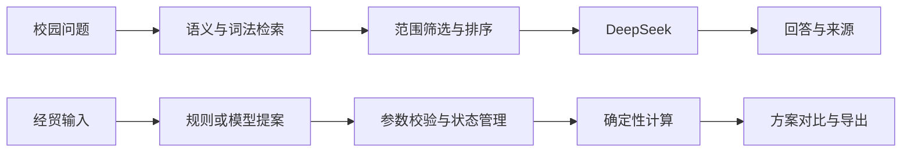

# 小贸 · SUIBE Agent

面向上海对外经贸大学的校园知识问答与经贸案例应用。校园问答基于检索证据生成回答；经贸计算使用确定性工具，支持多轮参数修改、方案比较与摘要导出。

## 功能

- **校园问答**：中文混合检索、范围筛选、来源引用与条件澄清。
- **经贸案例**：FOB / CFR / CIF 报价、进口支出、汇率敏感性与多方案状态管理。
- **模型接入**：校园模块使用 DeepSeek Flash；经贸模块支持规则解析或 Chat Completions 参数提案。
- **评测**：计算参考值、状态回归、检索指标和回答用例分层管理。

## 快速开始

需要 Node.js 24。经贸规则模式无需密钥和模型下载。

```sh
git clone https://github.com/lrk7353-arch/suibe_agent.git
cd suibe_agent
npm run dev:trade
```

打开 `http://127.0.0.1:18870`。页面显示当前解析模式。

校园问答另需 Python、BGE 嵌入模型和 DeepSeek 密钥，见 [校园应用](apps/campus/README.md)。模型参数提案配置见 [经贸应用](apps/trade/README.md)。

## 架构



Node.js 提供网页和应用接口，Python 承担嵌入与检索。金额由工具计算，模型参与语言理解和解释。详见 [架构说明](docs/architecture.md)。

## 目录

```text
apps/
  campus/       校园网页、API、检索与样例数据
  trade/        经贸网页、状态引擎、计算与测试
evaluation/     校园评测用例、脚本与历史基线
docs/           架构、数据与开发说明
scripts/        仓库级测试入口
```

## 测试

需要 Python 3，可通过 `PYTHON` 指定解释器。以下测试不调用付费 API。

```sh
npm test
npm run test:trade
npm run test:api
```

规则与工具测试 41/41，核心流程重复测试 72/72；校园评测集含 115 条用例。真实 API 生成与端到端回答评测尚未完成。口径见 [评测说明](evaluation/README.md)。

## 数据与模型

仓库提供官方借阅服务页样例及校园网工具资料，保留来源 URL。完整知识库与模型权重独立管理，见 [数据说明](docs/data.md)。校园 API 会发送问题与选定证据片段，密钥仅由服务端环境变量读取。

本地 Gemma 版本独立维护，当前默认入口为 API 与规则模式。

## 开发

见 [CONTRIBUTING.md](CONTRIBUTING.md)。维护团队：let me go（孔令睿、陈相彤）。项目未指定统一开源许可证；第三方组件、模型与来源资料遵循各自许可条件。
